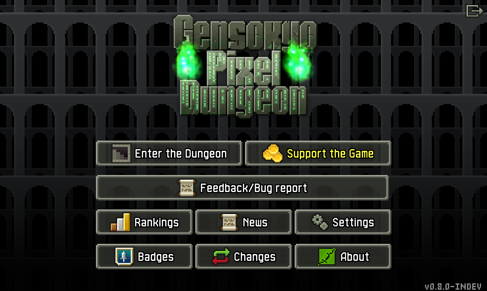
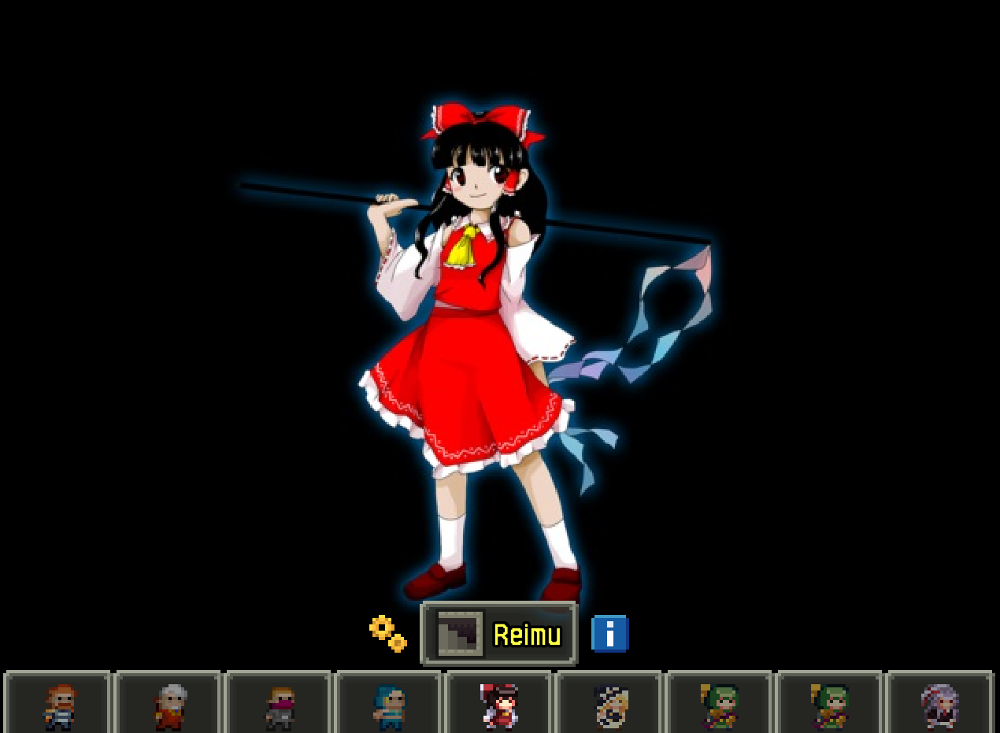
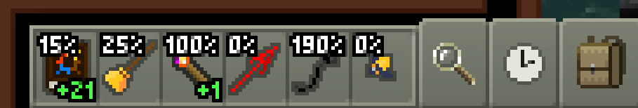
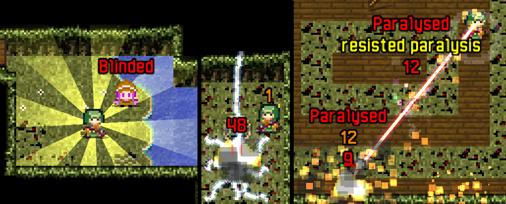
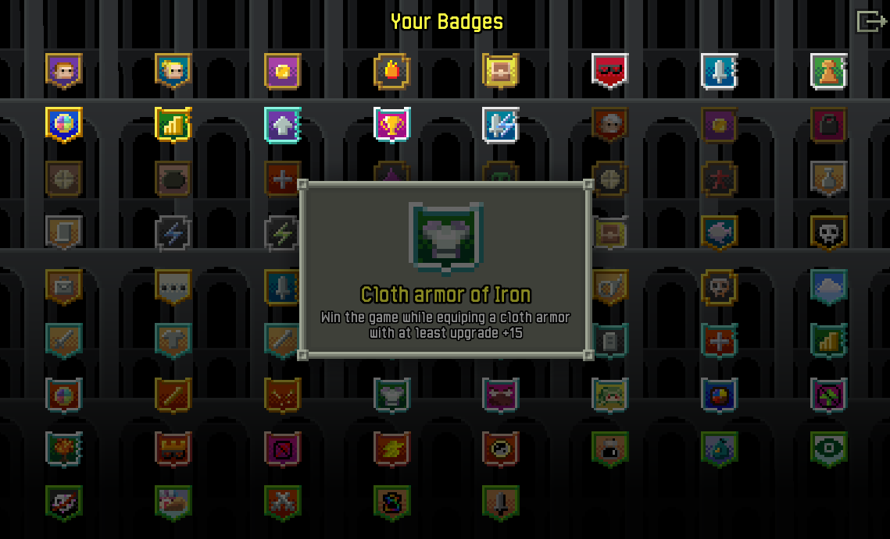

# Gensokyo Pixel Dungeon

This is forked from Shattered PD v1.3.1. Inspired by (old) TouhouPD and Tomorrow's RougeNights. The game also borrow idea from some other forks.

# FINAL UPDATE (11/06/2025 - 11, June, 2025) - WALL OF TEXT WARNING
To the few people who get to read this:
I've pretty much stopped working on this repo ever since I got a real job last year. Now I' a bit free again, but I haven't kept up with SPD and lost the design document (and idea dump) for this game, so even I'm lost on where to resume. I do remember working on a 6th area, Autumn Forest/Youkai Mountain based on TH10 but I couldn't finalize and balance the enemy there.

Anyway, this repo won't get more updates. The last apk build on the released site should work. If you want to fork this repo then go ahead, might want to fork a few commits before the last one in case things break.

Current state of the repo:
- Gensokyo Challenge: This is the actual game, I RECOMMEND ALWAYS TURNING THIS ON. I kept the original dungeon for balancing and testing.
    + 4 new Area: Forest Of Magic, Scarlet Mansion, Yukari's Shrine, Bamboo Forest. With their own mobs and skill.
    + Most enemies have skills, or certain interactions that force you to be moving around more, it's different than the usual close combat 1vs1 approach in normal SPD.
    + I did redraw a lot of enemies, but the area art are still from TouhouPD.
    + Each area has its own boss that, again, force you to move around a lot to dodge. They will still retaliate with normal attack when you attack them so don't ignore your armor.

    + NPCs: I added a bunch of NPCs and quests. I plan for some of them to have permanent effects/knowledge that carries over all games, I don't remember how much I have made them, though.
    + Those effect were implemented through Encounter system, basically a note about each NPCs and what they taught you, something something Youmu's sword to stage 3, something something add Fire to Tenshi's Fire rod, something something drink Hourai elixir, etc
    + A bunch of secrets too: Drinking Hourai elixir is one of them, then try meeting NPCs when you are running back while carrying the Amulet, or try to clear their quest by doubling their initial requirement then something good might happen, get the Spellbook to 1000% with Suika's drink, etc etc.
    + A bunch of new badges, for fun and to encourage players to interact with NPCs more.

- Lunatic Challenge: For high challenge enjoyers, I think it will make the game a lot more... interactive since this buffs the enemy, not shooting yourself in the foot like most other challenges. Work with both normal SPD dungeon and Gensokyo Dungeon.

- Weapon with SP: These tend to be straight up stronger than normal vanilla weapons, the stats are slightly lower to compensate but it's not enough. The skills are too burst-y so to really balance it, I wil have to lower the number more than whatever I have now, but that's not fun xP Touhou is a theme that you can be as creative as you want

- Touhou character that based on the 4 based character in SPD, Reimu is Warrior but offensive, Marisa is Mage but brute force with Hakkero, Koishi is Thief but different steath mechanic (or permanent Berserk, yet another secret?), Reisen is Huntress but brew drugs or go bam bam.

- Most of the enemies art and new weapon art a draw by me, feel free to use them, just a general credit like: "From GensokyoPD" and link this repo is fine.

- I'll include my last working build into the releases Tag

# OLD README SECTION
# Progress 

(Base on the source code, not the released files so some of this may not be in the apk/jar you downloaded):
- 4 new characters, their playstyle loosely based on the 4 original classes. (Plus Sakuya who is a broken character. You can pick her to handicap yourself since half her kit doesn't work)

- All new character have their own unique subclasses, no unique armor ability as of now.
- A bunch more weapon to spice up the gameplay. Including secret weapons!

- New Weapon SP mechanic: some weapons have special skill(s). You can gain "skill points" to use them by just hitting the enemies

- New challenge "Lunatic": all enemy have additional perk/skill. This make the game more dynamic, force you to run around a bit more!
- Alternative path (Currently up to 20 floors) - the "Gensokyo" challenge: New enemies, new bosses. My aim is it to be harder in general but easier if you don't get gang up on. Read monster's description, dodge their skill! Except lots of repositioning, don't too rely on narrow pathway!

# Plan:
- Finish and flesh out the first 4 regions. 3rd boss is unfinished and there are lots of unintended behavior (due to bad coding)
- Draw more! Currently I borrow a lot from TouhouPD for the aesthetic.
- More weapons!
- Introducing "Encounters", if you meet some NPC and meet their requirement, they may unlock something new permanently. For replayability purpose.
- A few more spells/items that can synergy with weapon skill and help adapt with new challenges.
- Finishing the NPCs
- Music (will compressed) and SFX
- Making unique armor ability
- Badges: For the new stuff

# My goal:
- Is to make SPD but with different approach, more option and playstyle to go for and have more replayability.

If there is any issue, you can use the feedback link inside the game or find me on Pixel Dungeon Discord.

# ShatteredPD
A Roguelike RPG, with randomly generated levels, items, enemies, and traps! Based on the [source code of Pixel Dungeon](https://github.com/00-Evan/pixel-dungeon-gradle), by [Watabou](https://www.watabou.ru).

Shattered Pixel Dungeon currently compiles for Android, iOS and Desktop platforms. It is available from [Google Play](https://play.google.com/store/apps/details?id=com.shatteredpixel.shatteredpixeldungeon), [the App Store](https://apps.apple.com/app/shattered-pixel-dungeon/id1563121109), and right here on [GitHub](https://github.com/00-Evan/shattered-pixel-dungeon/releases).

If you like this game, please consider [supporting me on Patreon](https://www.patreon.com/ShatteredPixel)!

There is an official blog for this project at [ShatteredPixel.com](https://www.shatteredpixel.com).

The game also has a translation project hosted on [Transifex](https://www.transifex.com/shattered-pixel/shattered-pixel-dungeon/).

Note that **this repository does not accept pull requests!** The code here is provided in hopes that others may find it useful for their own projects, not to allow community contribution. Issue reports of all kinds (bug reports, feature requests, etc.) are welcome.

If you'd like to work with the code, you can find the following guides in `/docs`:
- [Compiling for Android.](docs/getting-started-android.md)
    - **[If you plan to distribute on Google Play please read the end of this guide.](docs/getting-started-android.md#distributing-your-apk)**
- [Compiling for desktop platforms.](docs/getting-started-desktop.md)
- [Compiling for iOS.](docs/getting-started-ios.md)
- [Recommended changes for making your own mod.](docs/recommended-changes.md)
